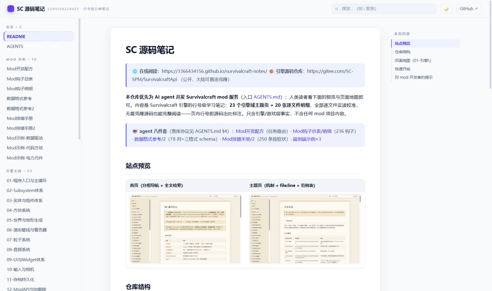
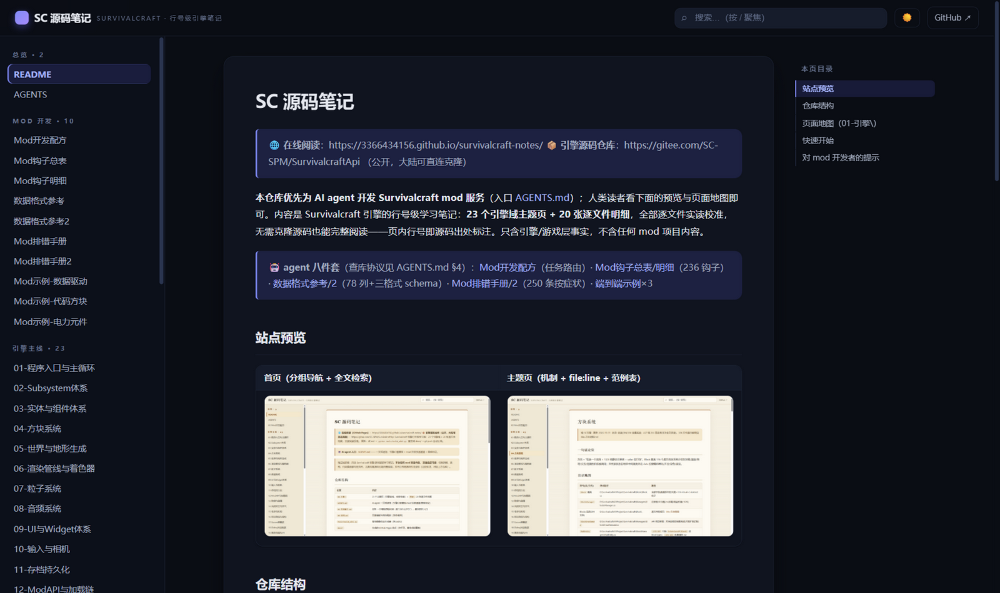
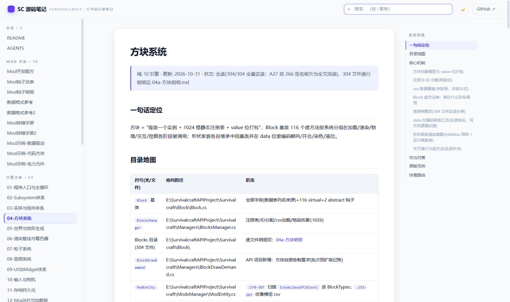

# SC 源码笔记

> 🌐 **在线阅读**：https://3366434156.github.io/survivalcraft-notes/  
> 📦 **引擎源码仓库**：https://gitee.com/SC-SPM/SurvivalcraftApi （公开，大陆可直连克隆）

**本仓库优先为 AI agent 开发 Survivalcraft mod 服务**（入口 [AGENTS.md](AGENTS.md)）；人类读者看下面的预览与页面地图即可。内容是 Survivalcraft 引擎的行号级学习笔记：**23 个引擎域主题页 + 20 张逐文件明细**，全部逐文件实读校准，无需克隆源码也能完整阅读——页内行号即源码出处标注。只含引擎/游戏层事实，不含任何 mod 项目内容。

> 🤖 **agent 八件套**（查库协议见 AGENTS.md §4）：[Mod开发配方](Mod开发配方.md)（任务路由）· [Mod钩子总表](Mod钩子总表.md)/[明细](Mod钩子明细.md)（236 钩子）· [数据格式参考](数据格式参考.md)/[2](数据格式参考2.md)（78 列+三格式 schema）· [Mod排错手册](Mod排错手册.md)/[2](Mod排错手册2.md)（250 条按症状）· [端到端示例](Mod示例-数据驱动.md)×6（数据驱动/代码方块/电力元件/自定义生物/自定义界面/自定义特效）· [24-机制全链](01-引擎/24-机制全链.md)（跨域挂点定位）

## 站点预览

| 首页（亮色） | 首页（暗色，自动跟随系统 + 一键切换） | 主题页（右侧可跳转目录） |
|---|---|---|
|  |  |  |

## 仓库结构

| 位置 | 内容 |
|---|---|
| `AGENTS.md` | **agent 入口**：引擎心智模型 + 查库协议（挂全部 8 份 agent 参考） |
| `学习路线.md` | **人类入口**：三条上手路径（做 mod / 读引擎 / 查问题）+ 20 词概念词典 |
| `Mod开发配方.md`、`Mod钩子总表/明细.md`、`数据格式参考/2.md`、`Mod排错手册/2.md`、`Mod示例-*.md` | agent 八件套：任务路由 / 236 钩子编目 / 数据格式 schema / 250 条排错 / 6 个端到端示例 |
| `01-引擎\` | 23 个主题页（引擎各域，全部全读）+ `明细\` 20 张逐文件档案 |
| `media\` | 站点预览截图 |
| `tools\` | `build_wiki.py` 站点生成器 · `coverage_audit.py` 源码↔笔记覆盖对账 |
| `docs\` | 生成的 GitHub Pages 站点（重生成即覆盖） |

## 页面地图（01-引擎\）

| 页 | 覆盖 | 全读(N/M) · 明细 |
|---|---|---|
| [01-程序入口与主循环](01-引擎/01-程序入口与主循环.md) | Program/Window/ScreensManager/GameScreen 一帧全序 | — |
| [02-Subsystem体系](01-引擎/02-Subsystem体系.md) | Subsystem/Project/加载保存/更新驱动 + 40 业务子系统 | 111/111 · [02a](01-引擎/明细/02a-子系统明细.md) |
| [03-实体与组件体系](01-引擎/03-实体与组件体系.md) | Entity/Component 契约 + 91 组件族 + EntitySystem | 91/91 · [03a](01-引擎/明细/03a-组件明细.md) |
| [04-方块系统](01-引擎/04-方块系统.md) | Block 116 虚方法/BlocksManager/304 方块 | 304/304 · [04a](01-引擎/明细/04a-方块明细.md) |
| [05-世界与地形生成](01-引擎/05-世界与地形生成.md) | 区块十态/五代TCG/TS23持久化 | 全读 · [05a](01-引擎/明细/05a-地形生成明细.md) |
| [06-渲染管线与着色器](01-引擎/06-渲染管线与着色器.md) | Graphics/语义头/预乘alpha/批次 | 71/71 · [06a](01-引擎/明细/06a-渲染管线明细.md) |
| [07-粒子系统](01-引擎/07-粒子系统.md) | ParticleSystem 基类与新增 5 步 | 28/28 · [07a](01-引擎/明细/07a-粒子明细.md) |
| [08-音频系统](01-引擎/08-音频系统.md) | OpenAL/播放链/格式嗅探/游戏层播放全链 | 引擎+游戏层 · [08a](01-引擎/明细/08a-音频明细.md) |
| [09-UI与Widget体系](01-引擎/09-UI与Widget体系.md) | 布局/命中/Update必调base/XML解析 | 106/106 · [09a](01-引擎/明细/09a-Widget明细.md) |
| [10-输入与相机](01-引擎/10-输入与相机.md) | 输入分发/键位/相机类族/VR手势 | 19+13+消费侧 · [10a](01-引擎/明细/10a-输入相机明细.md) |
| [11-存档持久化](01-引擎/11-存档持久化.md) | 存档 6+9 步/ValuesDictionary 硬拆箱 | 88/88 · [11a](01-引擎/明细/11a-序列化明细.md) |
| [12-ModAPI与加载链](01-引擎/12-ModAPI与加载链.md) | modinfo 13键/加载 20 步/HarmonyX | 72/72 · [12a](01-引擎/明细/12a-ModsManager明细.md) |
| [13-物理与碰撞](01-引擎/13-物理与碰撞.md) | ComponentBody 全链/碰撞对O(n²)/弹道/爆炸 | 全读 |
| [14-光照天空与天气](01-引擎/14-光照天空与天气.md) | 光照0-15/昼夜曲线/天气状态机 | 全读 |
| [15-电学与机构](01-引擎/15-电学与机构.md) | 电路 tick 链/自定义元件 4 步/51元件+12机构 | 51/51 · [15a](01-引擎/明细/15a-电学元件明细.md) |
| [16-玩法物品与背包](01-引擎/16-玩法物品与背包.md) | Game\ 玩法层：玩家/库存/合成/掉落/世界设置 | 298 文件 · [16a](01-引擎/明细/16a-Game明细.md)/[16b](01-引擎/明细/16b-Game明细2.md) |
| [17-Screen屏幕族](01-引擎/17-Screen屏幕族.md) | 71 屏幕组织与切换协议 | 71/71 · [17a](01-引擎/明细/17a-Screen明细.md) |
| [18-Dialog对话框族](01-引擎/18-Dialog对话框族.md) | 57 对话框 10 家族 | 57/57 · [18a](01-引擎/明细/18a-Dialog明细.md) |
| [19-媒体动画与VR](01-引擎/19-媒体动画与VR.md) | Engine.Media/Animation/VR(含 OpenXR 全链) | 140/140 · [19a](01-引擎/明细/19a-媒体动画明细.md) |
| [20-内容与资源管理](01-引擎/20-内容与资源管理.md) | ContentManager/scmod/导入链 | 全读 · [20a](01-引擎/明细/20a-内容资源明细.md) |
| [21-Engine核心运行时](01-引擎/21-Engine核心运行时.md) | Engine\Engine\ 平台层：窗口循环/日志/调度/墙钟 | 41/41 · [21a](01-引擎/明细/21a-Engine核心明细.md) |
| [22-数据资产与Database](01-引擎/22-数据资产与Database.md) | Content/Assets 数据资产(Database.xml/配方/衣物/UI XML) | 全读 · [22a](01-引擎/明细/22a-数据资产明细.md) |
| [23-内嵌浏览器](01-引擎/23-内嵌浏览器.md) | WASM/Emscripten 平台后端：双缓冲输入/共享内存 Content.zip/GL 委托锚 | 13/13 |
| [24-机制全链](01-引擎/24-机制全链.md) | 跨域六链逐步串联（挖方块/放置/实体帧/生物一生/电路步/加载保存）×mod 挂点 | 衔接步 2026-11-01 实读 |

## 快速开始

1. **选路线**：先看 [学习路线](学习路线.md)——做 mod / 读引擎 / 查问题三条路径 + 概念词典。
2. **读**：页面地图选页 → 页内"快查路由"直达小节；站点内按 `/` 搜索。
3. **写 mod**：先看 [Mod开发配方](Mod开发配方.md)（任务 → 照抄哪里），配合 [AGENTS.md](AGENTS.md) 的引擎心智模型；端到端样例抄 [Mod示例](Mod示例-数据驱动.md)。
4. **对照源码**：克隆上方 Gitee 仓库到本机，页内"目录地图"的绝对路径+实读行号可直接 `file:line` 跳转核对；页面没覆盖的可以 Grep 源码并把发现回写进对应页面（库越用越准）。

## 对 mod 开发者的提示

- 页首状态行的"全读(N/M)"= 该目录源码文件实读覆盖数。
- mod 挂点（UpdateComponentBody、OnLightningStrike、GenerateChunkLightSources 等）在各页"原版范例/快查路由"中有引擎侧位置；实际用法案例不在本库收录范围。
